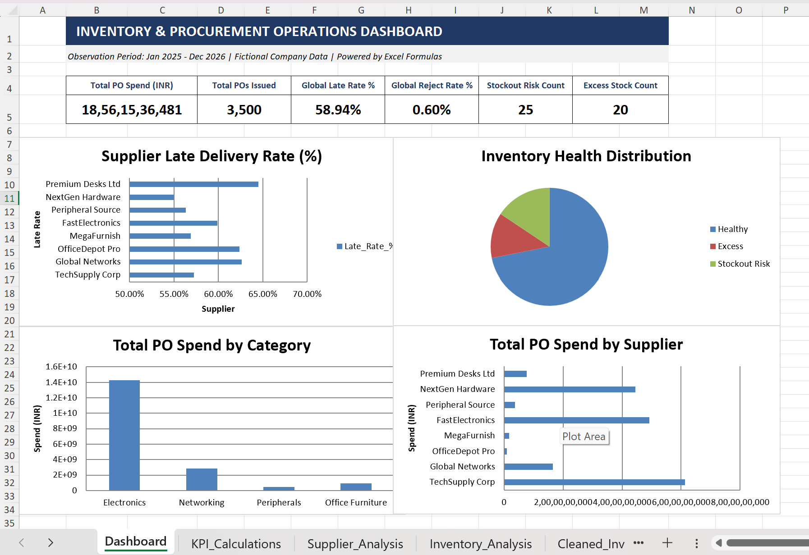
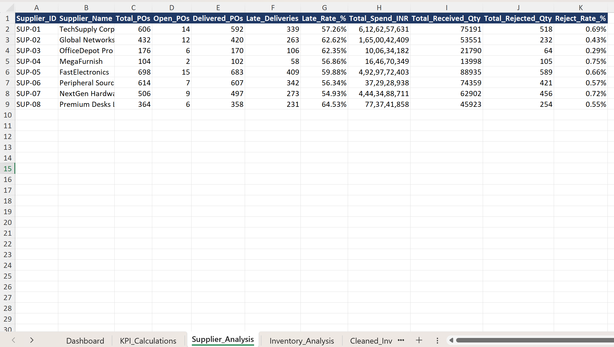
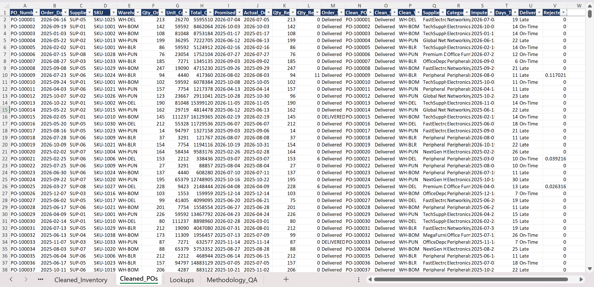
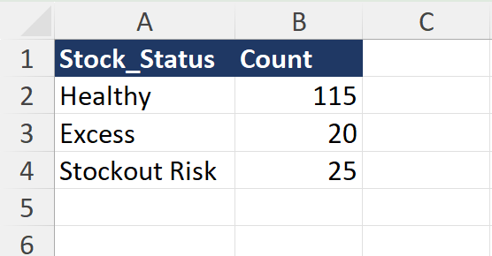
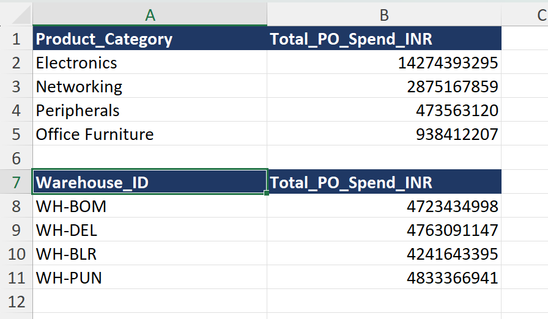

# Inventory & Procurement Operations Analytics — Excel Business Analysis

## Business context
This project examines procurement spend, supplier delivery reliability, receipt quality, and inventory availability for a fictional organisation, **NexaCore Hardware & Enterprise Supply**. It is structured as an operations-focused business analysis: define the management questions, establish consistent KPI rules, assess data quality, identify process and inventory risks, and translate findings into practical follow-up decisions.

**Scenario period:** 1 January 2025–15 December 2026  
**Reporting cutoff:** 15 December 2026 (simulated; not live operational reporting)  
**Data:** Synthetic purchase-order, inventory, supplier, product, and warehouse records  
**Tools:** Microsoft Excel, lookup and conditional formulas, data cleaning, KPI analysis, and dashboard charts

> **Data notice:** All company, supplier, product, and transaction data is fictional and synthetic. Results are illustrative and do not represent real operational performance.

## Business objectives and stakeholder decisions
The analysis is intended to support:
- **Procurement managers:** monitor purchasing spend, supplier delivery reliability, and supplier follow-up priorities.
- **Warehouse and inventory leads:** identify SKU–warehouse locations requiring replenishment, transfer, or excess-stock review.
- **Quality teams:** monitor rejected receipts and investigate recurring supplier/product issues.
- **Operations leadership:** review headline KPIs, agree on action owners, and monitor operational exceptions.

## Business questions
- What is the total purchasing spend represented by the unique purchase-order population?
- Which suppliers have recurring delivery delays?
- What share of received quantity is rejected?
- Which SKU–warehouse combinations are below reorder level or holding excess stock?
- Which procurement and inventory issues should be prioritised for investigation?

## Executive KPI summary

| KPI | Result | Business definition |
|---|---:|---|
| Unique purchase orders | 3,500 | Unique POs after removing 45 duplicate records |
| Total PO spend | ₹18,561,536,481 | Sum of order values for unique POs |
| Late-delivery rate | 58.94% | Late delivered POs ÷ delivered POs |
| Rejected-quantity rate | 0.60% | Rejected quantity ÷ received quantity |
| Stockout-risk locations | 25 | SKU–warehouse rows below reorder level |
| Excess-stock locations | 20 | SKU–warehouse rows above 120% of target stock |

These results are calculated from the synthetic dataset using the workbook's stated business rules. They are not real company performance figures.

## Findings and business implications

1. **Supplier delivery reliability is a key review area.** The scenario's late-delivery rate is 58.94%. Procurement should review supplier-level scorecards, validate the causes of delay, and prioritise service-level discussions or qualified alternatives for critical items.
2. **Receipt rejection is comparatively low in the scenario.** The rejected-quantity rate is 0.60%. Continue incoming quality checks and investigate whether rejected quantities cluster around particular suppliers or products before changing inspection policy.
3. **Inventory is imbalanced across locations.** The workbook flags 25 SKU–warehouse combinations at stockout risk and 20 as excess. Validate demand, lead times, and transfer availability before expediting replenishment or deferring purchases.
4. **Data definitions affect management decisions.** Duplicate POs are removed before spend is calculated, open POs are excluded from the late-delivery denominator, and inventory flags are assessed at SKU–warehouse level. These rules help prevent misleading comparisons.

## Recommended management actions
- Review supplier scorecards and investigate the root causes of late delivery before renegotiating service levels.
- Prioritise stockout-risk locations after validating demand, lead time, criticality, and transfer options.
- Review excess-stock locations for inter-warehouse transfers, returns, or purchase-order deferral, subject to demand forecasts.
- Monitor rejected quantities by supplier and product before changing quality-control policy.
- Assign owners and review dates to supplier and inventory exceptions so that the dashboard supports follow-up, not just reporting.

These are proposed actions for the fictional scenario; no real operational intervention or measured improvement is claimed.

## Workbook and source data
- [Open the Excel dashboard workbook](Excel%20Workbook/Inventory_Procurement_Dashboard.xlsx)
- [Open the raw procurement and inventory dataset](Dataset/Inventory_Procurement_Raw_Dataset.xlsx)
- [Read the Business Requirements and KPI Definitions](documentation/Business_Requirements_and_KPI_Definitions.md)

### Workbook analysis layers
| Worksheet | Business purpose |
|---|---|
| `Dashboard` | Executive view of headline KPIs and charts |
| `KPI_Calculations` | Category-level spend summary |
| `Supplier_Analysis` | Supplier-level PO, delivery, spend, and rejection metrics |
| `Inventory_Analysis` | Stock-health counts |
| `Cleaned_POs` | Deduplicated POs, standardized fields, lookups, delivery classification, and rejection rate |
| `Cleaned_Inventory` | Stock health and inventory value by SKU and warehouse |
| `Lookups` | Supplier and product reference data |
| `Methodology_QA` | Workbook notes and limitations |

## Dashboard and supporting evidence

### Executive dashboard


### Supplier performance


### Cleaned procurement data


### Inventory analysis


### KPI definitions


## KPI definitions, data quality, and assumptions
- **Unique POs:** Count of unique purchase-order IDs after duplicate PO records are removed.
- **Total PO spend:** Sum of total order value for unique POs; this is not cash paid or invoice value.
- **Late-delivery rate:** Late delivered POs divided by delivered POs; open POs are excluded from the denominator.
- **Rejected-quantity rate:** Total rejected quantity divided by total received quantity; this is quantity-weighted, not an average of PO-level percentages.
- **Stockout risk:** Available stock is below reorder level.
- **Excess stock:** Available stock is above 120% of target stock.

The synthetic raw PO data contains 3,545 rows, including 45 duplicate PO records. The cleaned PO sheet contains 3,500 unique POs. The raw data also includes inconsistent status casing/spacing, warehouse ID trailing spaces, and 30 missing promised delivery dates. Excel formulas including `TRIM`, `PROPER`, `VLOOKUP`, `XLOOKUP`, `IF`, `COUNTIF/COUNTIFS`, `SUMIF/SUMIFS`, and date calculations are used to standardise and analyse the data.

Missing promised dates are estimated using order date plus the supplier's default lead time. These are estimates, not observed supplier commitments. Stock-health flags are calculated at SKU–warehouse level:
- **Stockout risk:** available stock < reorder level
- **Excess:** available stock > 120% of target stock
- **Healthy:** neither condition applies

The workbook uses formula-driven summary tables rather than native PivotTables and slicers. Dashboard charts visualise the existing summaries.

## Limitations
- All data and business entities are synthetic.
- The reporting cutoff is a simulated future date and must not be interpreted as current real-world reporting.
- The workbook is designed for Excel recalculation when opened. Verify formula results and chart appearance in your spreadsheet application.
- No native PivotTables or slicers are included.

## Repository structure
```text
Inventory-Procurement-Analytics-Excel/
├── Dataset/
│   └── Inventory_Procurement_Raw_Dataset.xlsx
├── Excel Workbook/
│   └── Inventory_Procurement_Dashboard.xlsx
├── Screenshots/
│   ├── 01-executive-dashboard.png
│   ├── 02-supplier-performance.png
│   ├── 03-cleaned-procurement-data.png
│   ├── 04-inventory-analysis.png
│   └── 05-kpi-definitions.png
├── documentation/
│   └── Business_Requirements_and_KPI_Definitions.md
└── README.md
```

## Skills demonstrated
Business problem framing, stakeholder and decision analysis, procurement KPI design, supplier performance analysis, inventory and replenishment analysis, data-quality controls, Excel formulas, dashboard reporting, and translating findings into operational recommendations.

## Author
**Sarthak Jaykar**  
[GitHub](https://github.com/sarthak-jaykar) · [LinkedIn](https://www.linkedin.com/in/sarthak-jaykar/)
